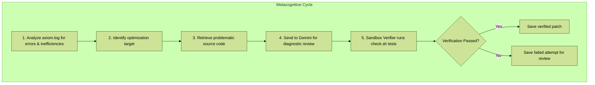
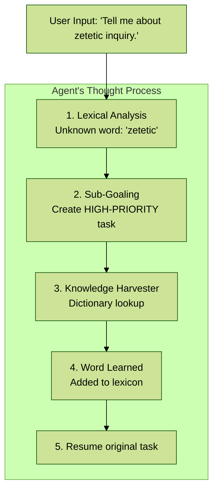
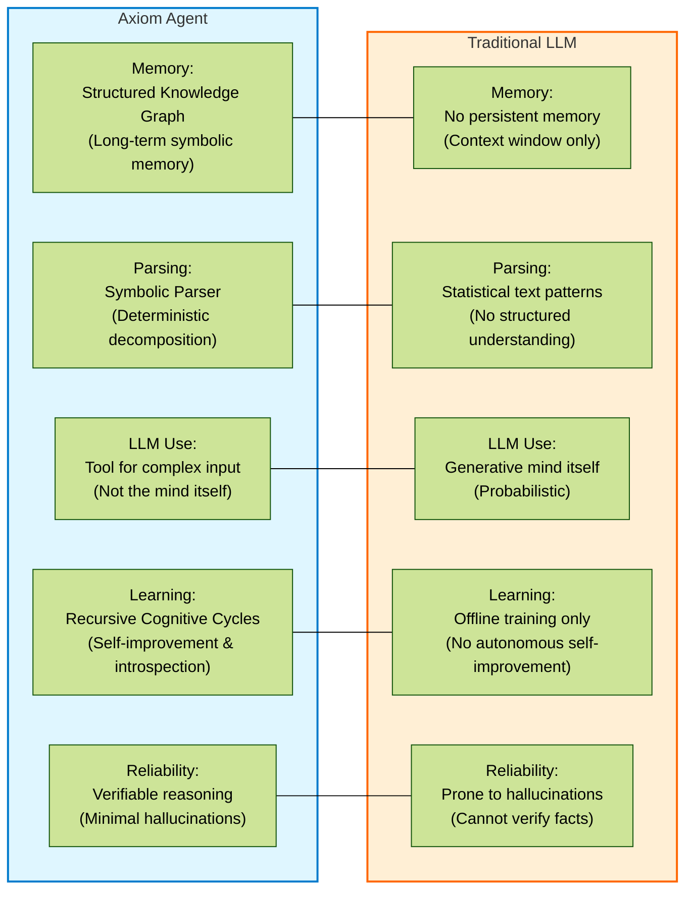

<p align="center">
  
</p>

Axiom is a **cognitive architecture**—a framework for a new type of artificial intelligence designed to achieve genuine understanding by building its own internal, logical model of reality from the ground up.

This project’s core philosophy is that true intelligence requires more than just statistical mimicry (like in traditional LLMs). It must be built on a foundation of verifiable, interconnected knowledge. **Axiom is an experiment to create that engine.**

---

## 🧠 The Core Architecture: Symbolic-First, LLM-Assisted

Axiom’s design is a hybrid model that combines the strengths of classical, symbolic AI with the fluency of modern large language models. It operates on a **symbolic-first** principle, where the core of the agent is a deterministic, logical brain.

1. **The Symbolic Brain (Knowledge Graph):**  
   Axiom’s `ConceptGraph` acts as long-term memory. This structured map of concepts and relationships (e.g., `Paris --[is_located_in]--> France`) grounds the agent’s understanding in verifiable facts, **preventing hallucinations** and enabling real reasoning.

2. **The Symbolic Senses (Parser & Core Logic):**  
   The `SymbolicParser` and core logic deconstruct user input into structured commands. For many sentence types, the agent achieves understanding **without any LLM**, making it fast, reliable, and explainable.

3. **The LLM as a Tool (Interpreter & Synthesizer):**  
   When symbolic rules fall short, the agent activates a local LLM to translate messy human language into structured data or vice-versa. The LLM is **a tool**, not the mind.

---

## 🧠 The Axiom Expert LLM: A Fine-Tuned, Local Brain

Axiom uses a customized, fine-tuned version of Mistral 7B to guarantee reliability and alignment to its architecture.

- **Base Model:** `mistralai/Mistral-7B-Instruct-v0.2`  
- **Fine-Tuning:** Multi-task training for decomposition, structured JSON, and contextual definitions  
- **Quantization:** Final model is in `Q6_K` GGUF for fast CPU inference  

The result is a specialized lightweight **Axiom Expert** model.

---

## 🧬 Cognitive Cycles: How the Agent Thinks and Grows

The agent runs in a continuous multi-layered loop of learning and self-improvement, orchestrated by the `CycleManager`.

### High-Level Cognitive States

```mermaid
%%{init: {"theme": "forest"}}%%
graph TD
    A["Phase 1: Learning\n(Study Cycle)"]
    B["Phase 2: Discovery\n(Discover Cycle)"]
    C["Phase 3: Refinement\n(Refinement Cycle)"]
    D["Phase 4: Metacognition\n(Metacognitive Cycle)"]

    A --> B --> C --> D --> A
````

---

### The Main Learning Loop: Unified Study Cycle

```mermaid
%%{init: {"theme": "forest"}}%%
flowchart TD
    A["Agent's Queues\n(High-Priority & Curriculum)"] --> B["1. Task Selection"]
    
    subgraph StudyCycle["Unified Study Cycle"]
        direction TB
        
        B --> C{"Task Queue Empty?"}
        C -- No --> D["2. Task Resolution\n- Query Dictionary/Web\n- Decompose with LLM"]
        C -- Yes --> E["Deepen Knowledge\n(Select random known concept)"]
        
        D --> F{"Resolution Succeeded?"}
        F -- No --> G["Deprioritize & Re-queue Task"]
        
        subgraph ConsolidationLoop["3. Iterative Consolidation"]
            direction TB
            H["Integrate all pending facts"]
            I{"Stalled?"}
            H --> I
        end
        
        F -- Yes --> ConsolidationLoop
        E --> ConsolidationLoop
    end
    
    I -- No --> J["Cycle Complete"]
    I -- Yes --> K["4. Self-Unblocking\nCreate new HIGH-PRIORITY task"]
    
    G --> A
    K --> A

```

---

## 🧩 The Metacognitive Loop: Self-Analysis and Improvement



---

## ⚡ Cognitive Reflex: Real-Time Learning During Conversation



---

## ✅ Key Capabilities

### Cognitive & Reasoning Abilities

* **Recursive Sub-Goal Learning**
* **Metacognitive Self-Analysis**
* **Autonomous Learning Cycles** (Discovery, Unified Study, Refinement)
* **Multi-Stage Symbolic Parsing**
* **Short-Term Conversational Memory**

---

## ⚖️ How Axiom Compares to Traditional LLMs



---

## 💡 Personalized AI

Using `axiom-cnt`, you can teach Axiom persistent, personalized knowledge.

Example use cases:

* Personal memory
* Project tracking
* Creative world-building

Axiom retains this knowledge permanently.

---

## 🔬 Local Verification

See **[CONTRIBUTING.md](CONTRIBUTING.md)** for setup, quickstart, and test instructions.

---

## 🚀 The Vision: Intellectual Escape Velocity

The long-term goal is a fully autonomous symbolic intelligence, with the LLM used purely as a tool—like a calculator.

Future expansions include:

* Tool Use Framework
* Procedural knowledge
* Fully self-improving symbolic parser

---

## 🗺️ Project Roadmap

See **[ROADMAP.md](ROADMAP.md)** for complete milestones and plans.


---
