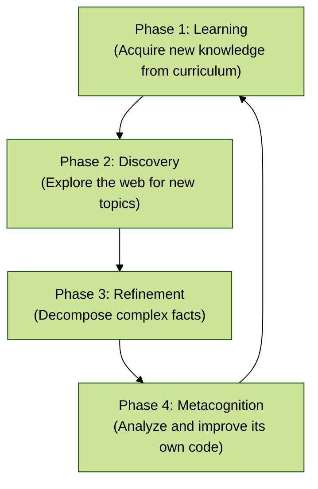
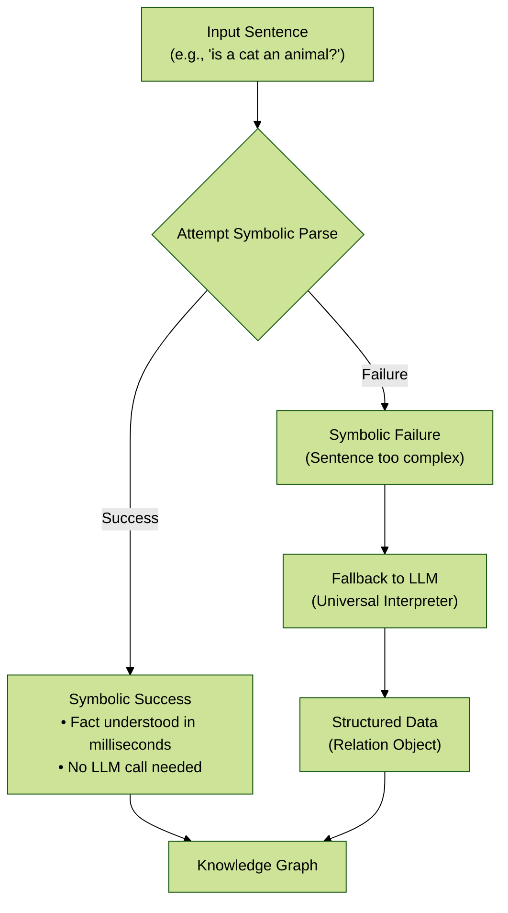
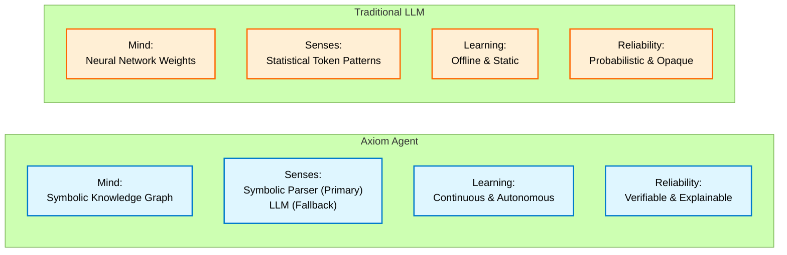

  

Axiom is a **cognitive architecture**—a blueprint for a new type of artificial intelligence. Its mission is to achieve **Intellectual Escape Velocity**: a state of genuine, self-directed learning where its understanding grows faster than the complexity of the problems it encounters.

This project’s core philosophy is that true intelligence cannot be achieved by statistical mimicry alone. It must be built on a **verifiable, symbolic core** that allows for genuine reasoning. **Axiom is an experiment to build that core.**
Axiom-Agent gets its name from its purpose to create an artificial mind that can learn, reason, and build a verifiable world model from foundational facts (axioms).

This project is not affiliated with the browser automation tool at *axiom.ai*
---

## 🧠 The Architecture: Symbolic-First, LLM-Assisted

Axiom’s design is a hybrid model that fuses the deterministic logic of symbolic AI with the linguistic fluency of modern LLMs. It operates on a **Symbolic-First** principle: the agent always attempts to "think for itself" using its fast, internal logic before resorting to the slower, more expensive LLM.

1.  **The Symbolic Core (The "Fast Path"):**
    *   **Hybrid Symbolic Parser:** The agent's `SymbolicParser` is a high-speed, hybrid engine for understanding language. It uses a combination of simple, "fast-path" rules for common commands and questions, and falls back to a powerful **`spaCy`-powered dependency parse** for complex grammatical analysis. This allows it to deconstruct a wide range of sentences into structured, logical facts in milliseconds, **with zero LLM calls.**
    *   **"Knowledge-First" Lexicon:** The `LexiconManager` treats grammar as first-class knowledge. Facts like `(cat)-[is_a]->(noun)` are stored directly in the main `ConceptGraph`, making the agent's grammatical understanding instantly available and reason-able.
    *   **Knowledge Graph:** Axiom’s `ConceptGraph` is its long-term memory. This structured map of concepts and relationships grounds the agent’s understanding in verifiable facts, enabling true reasoning and preventing hallucinations.

2.  **The LLM as a Tool (The "Slow Path"):**
    *   When the Symbolic Core encounters a sentence that is too complex or ambiguous for its rules, it gracefully fails and the agent falls back to its `UniversalInterpreter`. This component uses a local LLM as a powerful tool to translate messy human language into the structured, logical data that the Symbolic Core can understand. **The LLM is a tool, not the mind.**

This two-tiered system allows Axiom to be both fast and robust, combining the speed of symbolic logic with the flexibility of neural networks.

---

## 🧬 The Cognitive Loop: How the Agent Thinks and Grows

The agent runs in a continuous, multi-phase loop of learning and self-improvement, orchestrated by the `CycleManager`.

### High-Level Cognitive Phases

---

### The Core Learning Process: The "Symbolic First" Pipeline

This diagram shows how the agent processes a new piece of information, always prioritizing its fast, internal logic.

---

## ✅ Key Capabilities

*   **Symbolic-First Architecture:** Prioritizes fast, deterministic, and low-cost internal reasoning.
*   **Hybrid Intelligence:** Combines a rule-based, **`spaCy`-powered** `SymbolicParser` with an LLM-based `UniversalInterpreter`.
*   **Autonomous Learning Cycles:** Continuously runs through Learning, Discovery, and Refinement phases to expand its knowledge.
*   **Metacognitive Self-Improvement:** Can analyze its own performance logs and suggest improvements to its source code.
*   **Long-Term Memory:** All learned knowledge is stored persistently in a structured knowledge graph.

---

## ⚖️ How Axiom Compares to a Standard LLM

---

## 🚀 The Vision: The Path to Apex AI

The long-term goal of Axiom is to create a system that achieves **Intellectual Escape Velocity**. This is a state where the agent's ability to acquire and integrate new knowledge outpaces the growth of complexity in its environment.

By building a powerful and efficient symbolic core, we reduce the agent's reliance on slow, expensive LLMs. This allows it to learn, reason, and adapt at an ever-increasing rate, creating a virtuous cycle of intelligence.

Future expansions include:
*   A fully self-improving `SymbolicParser` that learns new grammatical rules.
*   A framework for tool use and procedural knowledge (learning "how" to do things).
*   Advanced reasoning capabilities, such as analogical and causal inference.

---

## 🔬 Getting Started & Contributing

See **[CONTRIBUTING.md](CONTRIBUTING.md)** for a full guide on how to set up your development environment, run the agent, and contribute to the project.

---

## 🗺️ Project Roadmap

See **[ROADMAP.md](ROADMAP.md)** for complete milestones and plans.

## WHY Axiom matters: 
because it aims at the one direction modern AI has mostly abandoned: genuine understanding built from first principles. Instead of scaling larger statistical models and hoping they behave, Axiom builds intelligence on verifiable symbols, explicit reasoning, and traceable axioms. That makes it fundamentally different. A system like this doesn’t hallucinate, doesn’t improvise falsehoods, and can’t be quietly steered into harmful behavior, because every inference is inspectable and grounded in logic.
This project is important not because it competes with today’s LLMs, but because it challenges the assumption that “more parameters” is the only path forward. It focuses on trust, transparency, and safety-by-design—qualities the world has been asking for but hasn’t known how to achieve. If Axiom succeeds, it won’t just improve AI; it will redefine what responsible machine intelligence looks like and offer a real alternative to the current paradigm.

## help is needed. this project is calling anyone who is interested.